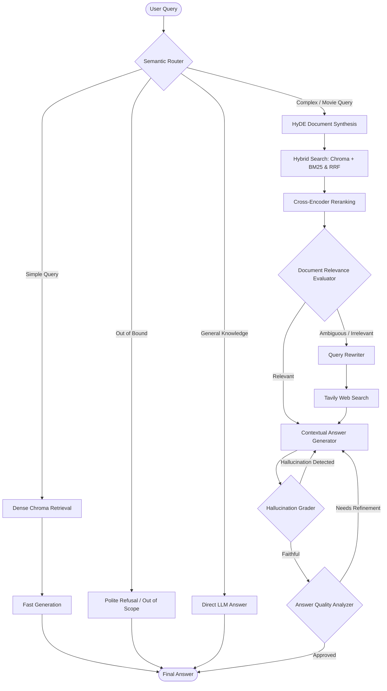

# Advanced Agentic RAG System

An enterprise-grade, self-reflective Retrieval-Augmented Generation (RAG) system built with **LangGraph**, **LangChain**, and **Google Gemini**. 

This system moves beyond naive RAG by implementing query routing, hypothetical document embeddings (HyDE), hybrid retrieval (dense embeddings + sparse BM25) with Reciprocal Rank Fusion (RRF), cross-encoder reranking, and automated self-correction loops for hallucination detection and answer quality grading.

---

## Architecture Overview



---

## Key Features

1. **Intelligent Query Routing:** Classifies incoming questions into Out-of-Scope, General Knowledge, Simple RAG, or Complex Hybrid RAG to optimize latency and token cost.
2. **HyDE (Hypothetical Document Embeddings):** Generates hypothetical document representations to significantly improve vector retrieval accuracy for nuanced questions.
3. **Hybrid Retrieval with Reciprocal Rank Fusion (RRF):**
   - **Dense Vectors:** ChromaDB with `BAAI/bge-small-en-v1.5` embeddings.
   - **Sparse Vectors:** BM25 lexical search (`rank-bm25`).
   - Merged and balanced dynamically using Reciprocal Rank Fusion scoring.
4. **Cross-Encoder Reranking:** Re-scores candidates using `cross-encoder/ms-marco-MiniLM-L6-v2` to pass only top-relevance context to the generator.
5. **Self-Reflective Loops (LangGraph StateGraph):**
   - **Relevance Evaluator:** Detects if retrieved docs are sufficient; if not, triggers query rewriting and web fallback.
   - **Hallucination Grader:** Validates generated claims strictly against source documents.
   - **Quality Analyzer:** Grades completeness and accuracy, iteratively refining answers up to 3 attempts.
6. **Web Search Fallback:** Integrates Tavily API for fresh or unindexed queries.

---

## Tech Stack

- **Orchestration:** LangGraph, LangChain Core
- **LLM:** Google Gemini via `ChatGoogleGenerativeAI`
- **Vector Database:** ChromaDB
- **Lexical Search:** Rank-BM25
- **Embeddings & Reranking:** Hugging Face `sentence-transformers` & `BAAI/bge-small-en-v1.5`
- **External Search:** Tavily API
- **Data Validation:** Pydantic v2

---

## Quickstart

### 1. Prerequisites & Environment Setup
Clone the repository and install dependencies using `uv` (or `pip`):

```bash
git clone https://github.com/eyyub679/advanced_rag.git
cd advanced_rag
uv sync
```

### 2. Configure Environment Variables
Copy the example environment file and add your API keys:

```bash
cp .env.example .env
```

Edit `.env`:
```ini
GOOGLE_API_KEY="your-gemini-api-key"
TAVILY_API_KEY="your-tavily-api-key"

# Optional (for re-ingesting dataset from TMDB)
TMDB_API_KEY="your-tmdb-api-key"
TMDB_URL="https://api.themoviedb.org/3"
```

### 3. Run the Agent

```bash
python main.py
```

Enter your query in the terminal. The agent will stream node completions showing routing, retrieval, reranking, and verification in real time!
